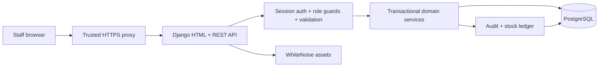
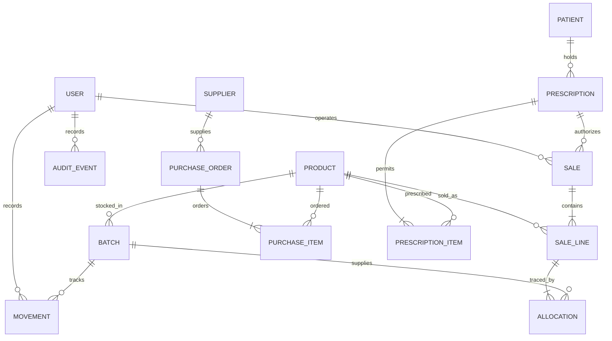

# Architecture and data design

## Stack and execution

A modular monolith: Django 5.2 LTS owns authentication, HTML rendering, ORM/migrations and transaction boundaries; Django REST Framework exposes `/api/v1/`; PostgreSQL 17 is required in production. Gunicorn runs WSGI; WhiteNoise serves local versioned static assets. No Node runtime or CDN is needed in production. SQLite is a development convenience and cannot validate row locking.

Templates handle navigation, lists, accessible forms, and receipts. Small local JavaScript modules handle catalog search, the POS basket and multi-line purchasing/prescription entry. They call the same authenticated API as integrations. Web forms and API handlers call the same domain services for every stock/financial operation. CSS/JS are local and covered by a self-only Content Security Policy; user text is escaped/textContent, not injected as HTML.

## Schema

Incremental migrations under `accounts/migrations` and `store/migrations` are authoritative. [Account DDL](accounts-schema.sql) and [domain DDL](store-schema.sql) are generated PostgreSQL migration output, not destructive bootstrap scripts. Django's own auth/session/admin tables accompany these.

| Entity | Key attributes / constraints |
|---|---|
| User | Unique username; Django password hash; ADMIN / MANAGER / PHARMACIST / CASHIER; active flag. Superuser is a bootstrap/emergency privilege. |
| LoginAttempt | Unique SHA-256 bucket key; failure count; 15-minute window. Account and source-IP buckets. No raw password stored. |
| Product | Unique SKU and optional unique barcode; MEDICINE/GENERAL; category and saleable unit; optional generic/strength; Rx and controlled flags; positive decimal price; 0–100% tax; reorder threshold; active flag. |
| Batch | Product + lot number unique; expiry optional for general goods, mandatory on medicine receipt; nonnegative quantity/cost; quarantine flag. |
| Movement | Batch, signed nonzero delta, kind, reason, operator, optional sale/PO references, timestamp. No mutation/delete endpoint. |
| Supplier | Unique name; contact/address; archive flag. |
| PurchaseOrder / PurchaseItem | Supplier/operator/state; unique product per order; positive quantities/nonnegative unit cost. OPEN → RECEIVED or CANCELLED only. |
| Patient | Name, phone, optional birth date, recorded allergies. Restricted access; allergies are notes, not automated clinical checks. |
| Prescription / PrescriptionItem | Unique external reference; patient/prescriber/registration; ordered validity dates; verifier and timestamp; cancellation; unique product per Rx; positive allowance and cumulative dispensed ≤ allowance. |
| Sale | UUID; unique (cashier, idempotency UUID); canonical request hash; decimal subtotal/discount/tax/total/paid; payment recording; refund metadata; FK references protected. |
| SaleLine / Allocation | Immutable product name/SKU/unit price/tax/discount/cost snapshots; positive quantities; explicit lot allocations. |
| AuditEvent | Operator/action/entity/ID/metadata/timestamp. Read-only API; written in the domain transaction. |
| StoreSettings | Singleton ID constrained to 1; store identity and receipt footer. Currency/timezone fixed to PKR/Asia-Karachi for this release. |

## Stock, checkout and refund invariants

1. The saleable balance is the sum of non-quarantined lots with no expiry or an expiry **after** the Pakistan business date. Stock is never independently stored on Product. Archived products cannot be received/sold.
2. Every service that changes stock locks the base Product rows in ascending ID order, then its lots. PostgreSQL supplies real `SELECT FOR UPDATE` semantics. Checkout also locks its operator before resolving an idempotency request. PO receipt locks the order before products; refund locks its existing sale before products. No path requires a lock held in the reverse dependency direction.
3. FEFO consumes earliest expiry first, non-expiring goods last, ID tie-breaker. A single product quantity can span multiple lots. No unallocated sale is permitted.
4. Checkout uses current database prices and tax rates, not submitted totals. PKR Decimal arithmetic rounds half-up to two decimals. Fixed discounts require manager/admin privileges and are allocated using remaining-discount/remaining-subtotal weights, avoiding negative penny lines. Tax is calculated per discounted line and summed.
5. A checkout commits sale, snapshots, allocations, stock deductions, Rx counters, movements and audit together. Insufficient stock/payment/allowance leaves all unchanged. A repeated key and identical canonical payload returns the original sale; a changed payload returns 409. Pending browser retries retain the exact payload per operator tab, including after reload.
6. Only current, verified, uncancelled prescriptions with matching patients/items can authorize Rx-only items. Admin/pharmacist accounts can verify/dispense; managers/cashiers cannot. Staff assigning these clinical privileges must verify professional eligibility externally. Quantity allowances are cumulative; create a professionally reviewed new prescription for additional authorized quantities. No automatic refill policy is invented.
7. Controlled-drug products are blocked at checkout, including for administrators. There is no regulated register integration. General items never require a prescription. Product clinical classification cannot change after any batch exists; archive and create a new SKU instead.
8. Refunds are full-sale, once only, and require admin/manager plus a reason. Each original allocation becomes separate quarantined returned stock. Financial refunds do not replenish Rx allowance. Payment settlement is external. Partial refunds, automatic gateway refunds, stock transfers, fractional units and pack conversions are outside this release.
9. Reports aggregate sale headers separately from line cost and account for refunds on their actual refund date. Gross profit excludes net tax and net batch cost; operating expenses, general ledger, and quarantine write-off accounting are outside this scope.

## Authorization matrix

| Capability | Admin | Manager | Pharmacist | Cashier |
|---|:---:|:---:|:---:|:---:|
| Catalog read / non-Rx checkout | ✓ | ✓ | ✓ | ✓ |
| Catalog writes, receiving, counts, quarantine, suppliers, purchase creation/receipt | ✓ | ✓ | ✓ | — |
| Cancel open PO | ✓ | ✓ | — | — |
| Patient/Rx records, verification, Rx dispensing | ✓ | — | ✓ | — |
| Sales / receipts | All | All | All | Own |
| Discounts / full refunds / financial reports | ✓ | ✓ | — | — |
| Stock ledger | ✓ | ✓ | ✓ | — |
| Staff management / settings / audit trail | ✓ | — | — | — |

Accounts cannot deactivate/demote themselves through app/API. Only a superuser can edit another superuser. Staff management does not expose password hashes, staff/superuser switches, or arbitrary framework permissions. App admins do not automatically get Django admin access; the bootstrap superuser does. Domain data is intentionally not editable through Django admin.

## Validation, errors and observability

HTML forms validate required types and model constraints; API serializers limit sizes, counts, enums, dates, decimals, relationships and uniqueness. Business services enforce roles and cross-record/transaction rules. Database FKs/checks/uniqueness are the final line of defense. Checkout supports at most 100 distinct products and 1,000,000 whole units per line; monetary overflow is rejected before writing.

API errors use `{error: {status, details, request_id}}`. Validation returns 400, role/CSRF/auth failures 403, missing records 404, and business/idempotency/uniqueness conflicts 409. Unexpected API errors return generic 500. Request IDs are generated by the server and returned in `X-Request-ID`. JSON stdout logs contain route, method, duration, status and operator ID; request bodies, cookies, passwords and query strings are excluded. Business audit and movements are database records. They are append-only through the application, **not tamper-proof against a database owner**; use separate operational credentials, restricted access, off-host logging/backups, and retention controls in deployment.

HTTPS redirect, secure/HttpOnly/SameSite session cookies, CSRF, password validators, host/origin checks, HSTS, frame denial, self-only CSP, and generic production errors are enabled when DEBUG=false. Production requires PostgreSQL and SECRET_KEY. Forwarded-protocol trust is opt-in and requires an actual sanitizing TLS proxy. Login throttling reads REMOTE_ADDR only; configure a trusted proxy rate limit for per-client IP enforcement behind a shared proxy. The shared proxy IP bucket deliberately fails closed but can temporarily affect other staff after repeated failures.
